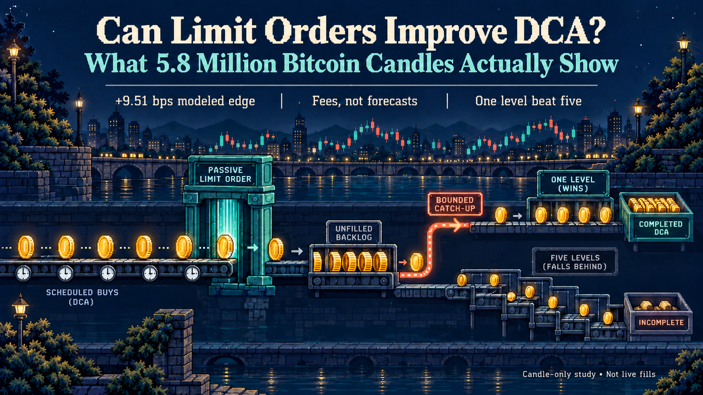

# Fee-Aware Passive DCA

**Candle-Only Evidence and Retail-Scale Feasibility for Bitcoin Accumulation**

Tao Tao · Independent Researcher  
NR-2026-001 · Working paper v1.0 · 9 October 2026 · Not peer reviewed

[中文](README.zh-CN.md) · [All papers](../../../README.md)

## Read and download

- [Full English manuscript](paper.md) and [technical appendix A–M](appendix.md).
- [完整中文论文](paper.zh-CN.md)与[中文附录](appendix.zh-CN.md)。
- [English PDF](pdf/fee-aware-passive-dca-working-paper-v1.0.pdf).
- [中文 PDF](pdf/fee-aware-passive-dca-working-paper-v1.0-zh-CN.pdf).
- [Full reading edition on NomanTrade](https://nomantrade.com/research/can-limit-orders-improve-dca/).
- [Short introduction on Medium](https://medium.com/@magictt1008/can-limit-orders-improve-dca-what-5-8-million-bitcoin-candles-actually-show-1e3fedad26b3).
- [Versioned release and downloads](https://github.com/MagicTaoT/noman-research/releases/tag/fee-aware-passive-dca-v1.0).

## Research question

Given an already chosen DCA cash schedule, can a passive-first limit-order
controller acquire more BTC than immediate taker execution after fees, while
explicitly carrying missed cash and completing it through bounded catch-up?

The evidence uses 5,837,137 Coinbase BTC-USD one-minute candles from 20 July
2015 through 6 October 2026 UTC. The locked primary test uses 588,240 obligations
of USD 10 every two minutes. It is a retrospective candle model, not a live
maker-fill study or a comparison of DCA with lump-sum investing.

## Main findings

| Primary 15/30 bps maker/taker scenario | Cash-weighted quantity edge |
| --- | ---: |
| Adaptive five-level controller | +9.5065 bps |
| Price-path contribution | −0.8710 bps |
| Fee contribution | +10.3775 bps |
| Fixed one-level reference | +12.8327 bps |

The lower fee explains the modeled advantage; forecasting lower prices does
not. The simpler one-level policy outperforms the proposed adaptive ladder.

Exploratory repricing at 35/75 bps produced 26.7472 bps for the five-level
controller and 36.6180 bps for the fixed one-level reference. These are fixed
scenario inputs, not a claim about a reader's current Coinbase fee tier.
Falling-market panels, minimum-order constraints and realistic monthly budgets
are covered in the full paper and appendix.

## Scope and limitations

- Candle penetration does not establish queue priority, a real fill, or maker status.
- Earlier exploration used the historical snapshot; the locked test is not pristine out-of-sample evidence.
- Retail, down-market and wider-fee analyses are post-plan exploratory extensions.
- Reported bps are execution-quantity measures, not annual returns or guaranteed profits.
- There is no additional exponential compounding effect under fixed contributions without reinvestment.

This package contains the complete publication, original figures, and the
[12 published aggregate tables](results/README.md). It excludes raw and derived
market records, the backtest engine, live trading code, account journals and
production configuration. It does not by itself permit a full rerun of the
experiment. Historical workspace artifact identifiers in Appendix M are
provenance references, not files included in this repository.

## Citation and integrity

Tao, T. (2026). *Fee-Aware Passive DCA: Candle-Only Evidence and Retail-Scale
Feasibility for Bitcoin Accumulation*. Independent working paper, v1.0,
9 October 2026.

[BibTeX citation](citation.bib) · [Metadata](metadata.json) · [Checksums](SHA256SUMS) · [Changelog](CHANGELOG.md)

The GitHub publication date is 13 October 2026; the manuscript date remains
9 October 2026. No DOI has been assigned. The PDFs are unchanged from the
NomanTrade publication. Markdown image links are localized for this repository;
no research result or substantive manuscript text has been changed.

The author reports no external funding or competing interests. AI-tool use
and author responsibility are disclosed in both manuscripts. The original
research materials are licensed under [CC BY 4.0](../../../LICENSE).
