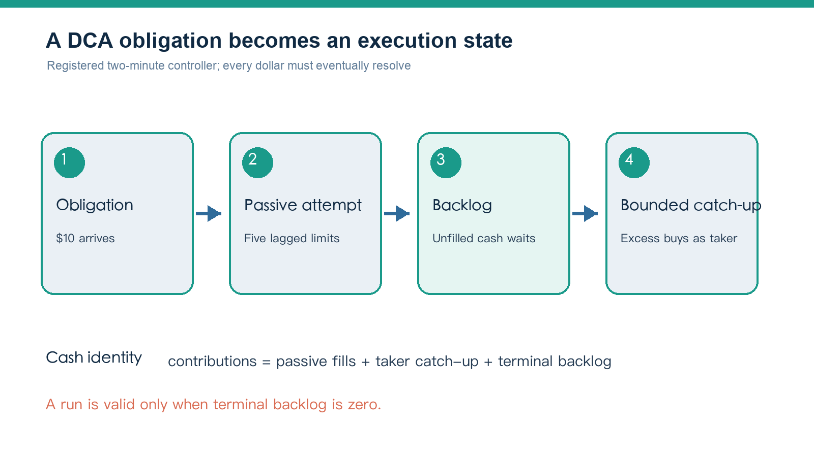
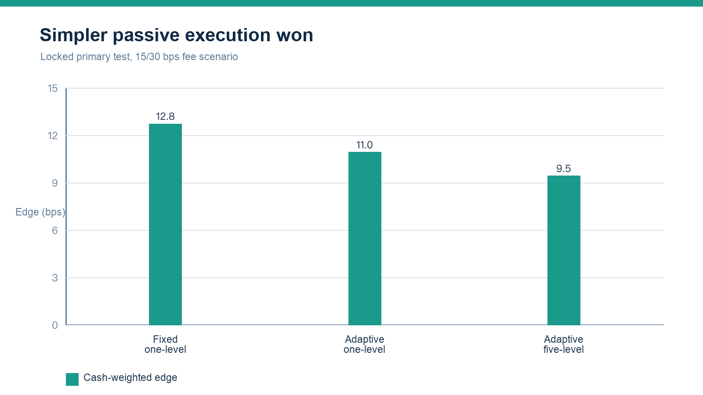
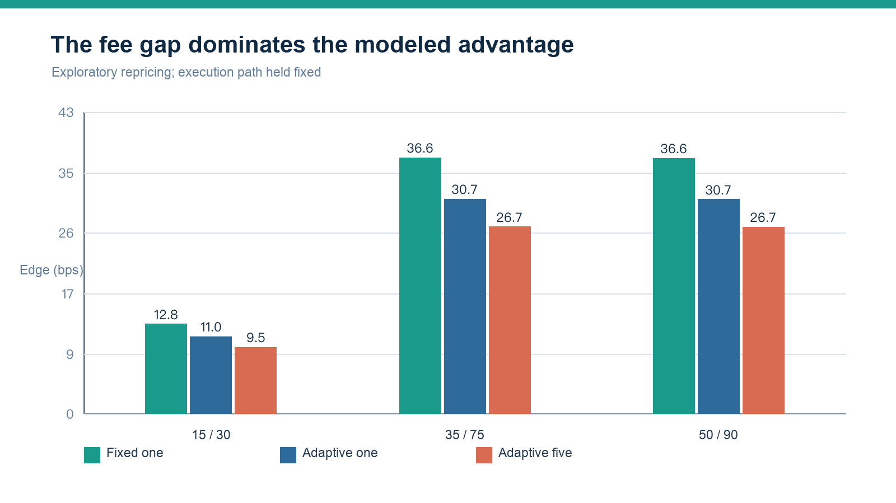
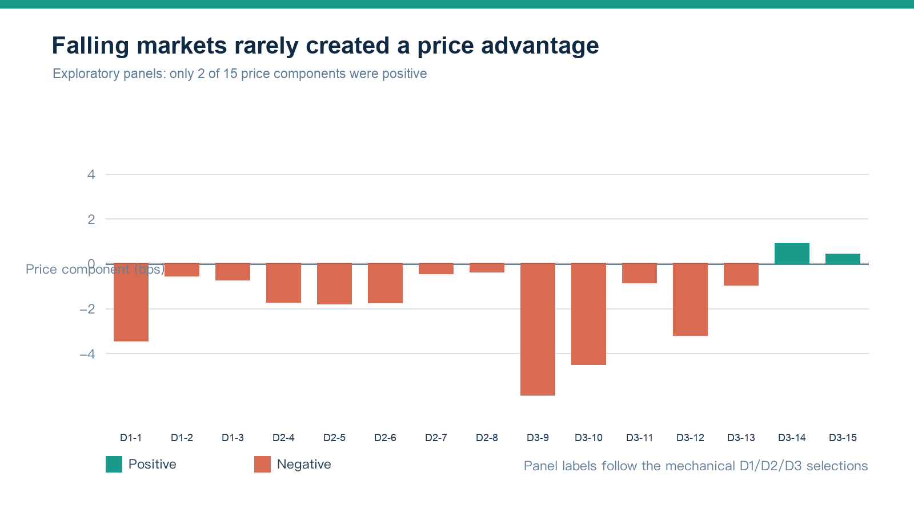
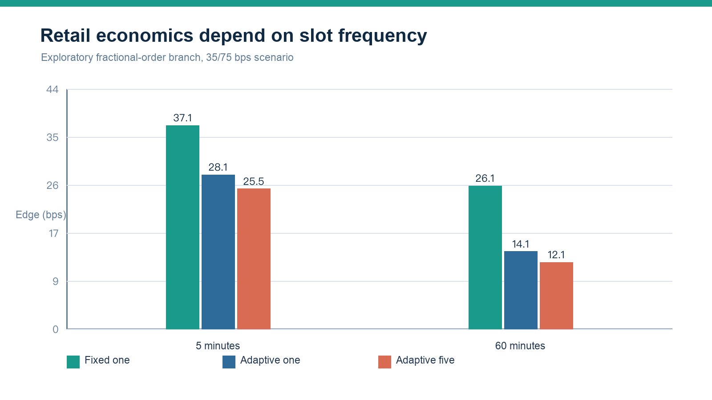
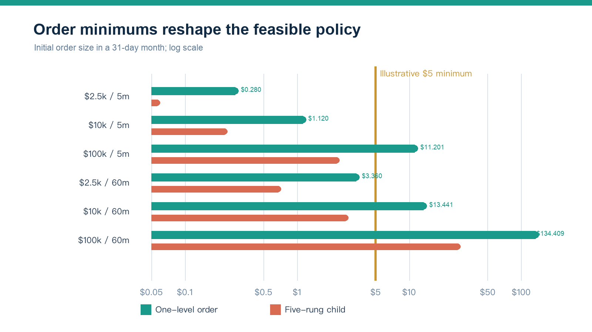

# Fee-Aware Passive DCA

## Candle-Only Evidence and Retail-Scale Feasibility for Bitcoin Accumulation

**Tao Tao**  
Independent Researcher  
Working Paper v1.0 — 9 October 2026

Evidence release: `MLDCA candle evidence v1`  
Registered protocol: `MLDCA-EP-1.1`  
Market: Coinbase BTC-USD spot  
Data: one-minute OHLC candles through 6 October 2026 UTC

## Abstract

Dollar-cost averaging (DCA) separates a saving decision from short-term market timing, but it does not determine how each scheduled purchase should be executed. An immediate purchase demands liquidity and pays the applicable taker fee. A resting limit order may pay a lower maker fee and occasionally buy at a lower price, but it can fail to fill and leave the investor holding cash while the asset rises. This paper evaluates a stateful passive-execution layer for an already-chosen DCA schedule.

The locked primary experiment assigns a USD 10 obligation every two minutes and compares immediate-taker execution with a five-rung passive limit-order controller. The controller uses only completed candles, carries missed cash as backlog, and forces bounded taker catch-up. On Coinbase BTC-USD one-minute candles, the registered 15/30 basis-point (bps) maker/taker scenario produced a cash-weighted quantity edge of 9.5065 bps; the one-sided 95% stationary-bootstrap lower bound was 9.2565 bps. The exact decomposition is more important than the headline: the price-path component was -0.8710 bps and the lower-fee component was +10.3775 bps. A fixed one-level passive reference achieved 12.8327 bps, outperforming the five-rung controller.

Post-plan exploratory analyses reach four further conclusions. First, a wider fixed fee gap mechanically increases the modeled benefit: the five-rung edge was 26.7472 bps at 35/75 bps and 26.7060 bps at 50/90 bps. Second, lower prices were not a reliable source of advantage: only 2 of 15 mechanically selected falling-market panels had a positive price component, although all 15 remained positive after fees in the tested scenarios. Third, with fixed cash contributions and no reinvested execution savings, terminal-wealth bps equal acquired-quantity bps; there is no separate exponential "execution compounding" term. Fourth, realistic minimum-order constraints materially change the design. Under an illustrative USD 5 minimum, monthly budgets of USD 2,500 or USD 10,000 favor hourly batching and a single passive order, while a five-rung ladder is often too fragmented.

These are candle-model results, not demonstrated live maker fills. One-minute lows do not reveal queue position, post-only acceptance, partial fills, latency, or historical product rules. The evidence supports a narrow claim: when the maker/taker fee gap is large enough, a simple passive-first, bounded-catch-up execution policy can reduce the modeled cost of a fixed DCA schedule. It does not support short-horizon price-prediction alpha or the superiority of a five-level ladder.

**Keywords:** dollar-cost averaging; limit orders; maker-taker fees; execution; Bitcoin; retail trading; backtesting

## 1. Motivation

DCA is best understood as a commitment rule. A saver chooses a budget and schedule, then keeps buying without requiring a fresh forecast at every decision. That behavioral robustness is distinct from the execution method used for each purchase. Prior research shows both why scheduled investment can be attractive to users and why it is not universally optimal once return dynamics and transaction costs are modeled (Constantinides, 1979; Khouja and Lamb, 1999; Kirkby, Mitra, and Nguyen, 2020).

For a frequent DCA schedule, execution becomes economically visible. An immediate order removes non-execution risk but pays for immediacy. A resting limit can reduce the fee and may capture a temporary decline, but the unfilled obligation becomes cash drag. If the investor eventually chases the market, the catch-up purchase may be worse than the original immediate execution. A useful passive DCA system therefore needs more than a limit price: it needs an obligation ledger, an explicit backlog, a deadline, and a rule for completing missed purchases.

The research question is conditional:

> Given a fixed stream of cash obligations, can a bounded passive-first execution policy acquire more BTC than immediate-taker execution after modeled fees, without hiding uninvested cash?

This is not a comparison of DCA with lump-sum investing, a trading signal, or an allegation about exchange intent. Exchange recurring-purchase products prioritize convenience and guaranteed completion; their exact routing can differ and is not inferred here. The contribution is to separate the user's saving policy from the venue-facing execution policy and to measure the latter on an equal-cash basis.

## 2. Relation to existing designs

Limit-order accumulation is not new. Calendar DCA using market or limit orders appears in US20130117198A1; a price ladder for accumulation appears in JP2015036969A; and US20190378214A1 describes passive components, missed-order state, and catch-up. Coinbase documents a TWAP order that begins passively and can become aggressive, while Hummingbot exposes a multi-price DCA executor. The present system should therefore not be described as the first limit-order DCA.

The closest academic frame is optimal execution with limit and market orders. That literature treats price, fees, non-execution risk, inventory, and completion constraints jointly (Almgren and Chriss, 2001; Cartea and Jaimungal, 2015; Cont and Kukanov, 2017). Queue-reactive work is especially relevant because a price touch is not a fill (Huang, Lehalle, and Rosenbaum, 2015). Make/take fees are market-design incentives, not free returns independent of adverse selection or queue risk (Foucault, Kadan, and Kandel, 2013).

The contribution tested here is narrower: represent a stream of small DCA purchases as a stateful execution problem; use only lagged information; carry missed cash explicitly; force bounded completion; attribute both strategies to the same cash obligations; and split any advantage into price and fee components. The study also reports a negative design result: under the registered candle assumptions, a complex five-rung controller performed worse than a fixed one-level passive reference.

## 3. Strategy and accounting

### 3.1 Obligation state

At slot `t`, a new cash obligation `c_t` arrives. If `B_t^-` is passive backlog entering the slot, available cash is

`I_t = B_t^- + c_t`.

The registered controller plans passive cash

`P_t = min(I_t, c_t + alpha B_t^-, M c_t)`,

with `alpha = 0.5` and `M = 5`. The primary policy splits this plan equally over five buy limits. Limits use percentiles of the minimum-return distribution from the previous 720 completed two-minute slots and are at least one basis point below the reference open. The current slot enters history only after its decisions are complete.

Unfilled cash returns to backlog. When passive backlog exceeds 15 slot budgets, excess cash is assigned to taker catch-up at no earlier than the next executable slot open. New obligations stop at the test boundary and a 24-hour settlement window remains. A run with unresolved cash is invalid rather than rewarded with an unequal-cash comparison.

*Figure 1. Registered candle-only state machine. It defines obligations, simulated passive attempts, backlog, and taker catch-up; it does not establish live fills.*

### 3.2 Baseline and policy quantities

For baseline price `A_t`, including registered taker spread/slippage, and taker fee `f_T`, BTC acquired from obligation `c_t` is

`q_t^B = c_t / [A_t (1 + f_T)]`.

For passive cash `m_tk` filled at limit `L_tk`, maker fee `f_M`, and taker catch-up cash `x_t` executed at `U_t`, policy quantity is

`q^S = sum(m_tk / [L_tk (1 + f_M)]) + sum(x_t / [U_t (1 + f_T)])`.

The budget identity is

`sum(c_t) = sum(m_tk) + sum(x_t) + B_T`.

Equal-final-cash comparison requires `B_T = 0`. This prevents a strategy from appearing superior merely because it failed to invest, although it does not remove the economic cost of delayed ownership.

### 3.3 Estimand and exact decomposition

Each original obligation is followed through FIFO attribution. If `q_i^S` and `q_i^B` are quantities assigned to obligation `i`, its edge is

`e_i = 10,000 (q_i^S / q_i^B - 1)`.

The registered headline is the cash-weighted mean of `e_i`. Because primary obligations are equal, it is also their arithmetic mean. This avoids allowing early low-price purchases to dominate the result simply because each dollar bought more BTC.

Under constant fees, the base-unit difference decomposes exactly into a price-path term evaluated at the taker fee and a fee-reclassification term on passive cash:

`Delta q_price = [sum(m/L) + sum(x/U) - sum(c/A)] / (1 + f_T)`,

`Delta q_fee = sum(m/L) [1/(1 + f_M) - 1/(1 + f_T)]`.

The first term asks whether waiting and catch-up improved execution prices. The second measures the mechanical quantity effect of applying the passive rather than taker fee to the same simulated passive fills.

## 4. Data and empirical design

The frozen input contains 5,837,137 Coinbase BTC-USD one-minute OHLCV rows from 20 July 2015 through 6 October 2026 UTC. The audit found no duplicate timestamps, out-of-order rows, or invalid OHLC rows. It marked 13,130 minutes below the protocol's USD 10 minute-notional threshold. Coinbase notes that candle intervals can be absent when no ticks occur and that historical candles can be incomplete.

The data were divided by frozen timestamps: development before 13 April 2022 UTC, validation through 9 July 2024, and test thereafter. Earlier exploration had already examined the historical snapshot, so these labels define roles in a locked retrospective protocol; they do not turn the test segment into pristine out-of-sample evidence.

The primary active-session test contains 588,240 USD 10 obligations, or USD 5,882,400 in each counterfactual. This is a research clock designed to produce many execution decisions, not a representative household budget. The exploratory retail analysis later replaces it with monthly budget wallets.

The registered primary cell is:

| Design element | Registered value |
|---|---:|
| Product | Coinbase BTC-USD spot |
| Slot and obligation | 2 minutes; USD 10 |
| Predictor | 720 completed slots; strictly lagged |
| Passive policy | 5 equal-cash percentile rungs; 1 bp minimum offset |
| Backlog controller | alpha 0.5; passive plan capped at 5 slot budgets |
| Catch-up | excess over 15-slot cap; next executable open |
| Candle trigger | 1-minute activation delay; 1 bp penetration |
| Simulated fill | 50% haircut; 1% of minute notional capacity |
| Primary fees | 15 bps passive; 30 bps taker; 2 bps taker slippage |
| Bootstrap | stationary daily blocks; expected length 7 days; 10,000 replicates |
| Primary threshold | one-sided lower 95% bound above 1 bp |

Fee pairs are experimental inputs, not claims about the fees of a specific account on a specific date. Actual Advanced fees depend on factors including product, tier, volume, and maker/taker status. The primary two-minute schedule would itself change rolling volume, but tier migration is deliberately not modeled.

The primary branch is `idealized_candle`. Dated historical minimum notionals, price increments, and size increments were not frozen. Five equal rungs can begin near USD 2, so the primary test does not establish that every child order was historically submit-able. A simulated passive fill requires an eligible candle after the activation delay to penetrate its limit by at least 1 bp; requested cash is then cut by 50% and constrained to 1% of minute notional. These rules reduce the most permissive touch model, but do not reconstruct event order, volume at price, queue ahead, rejection, latency, or actual maker classification.

## 5. Locked primary results

### 5.1 Headline and decomposition

The five-rung policy produced a cash-weighted obligation edge of **9.5065 bps**. The one-sided 95% bootstrap lower bound was **9.2565 bps**, the percentile upper bound was 9.7626 bps, and the centered-bootstrap one-sided p-value against the 1 bp threshold was 0.00010. All 588,240 obligations resolved and cash-conservation error was approximately USD 4.05e-8.

The price-at-taker-fee component was **-0.8710 bps** and the passive-fee component was **+10.3775 bps**. Simulated passive cash accounted for 69.27% of total cash and taker catch-up for 30.73%. Average outstanding backlog was USD 134.31 and maximum pre-catch-up backlog was USD 2,090. The model's benefit was therefore a fee effect purchased with real waiting and catch-up exposure, not evidence that the controller forecast lower prices.

The bootstrap interval measures historical path resampling under the registered candle model. It does not include pre-protocol specification search, fill-model error, venue-rule uncertainty, or future regime change.

### 5.2 The ladder did not add value

The fixed one-level passive reference achieved 12.8327 bps and the adaptive one-rung policy 11.0270 bps, versus 9.5065 bps for the five-rung policy. The paired five-minus-fixed contrast was -3.3262 bps, with a 95% interval of [-3.4900, -3.1543] bps. The fixed reference also had a higher simulated passive share (95.60%) and lower average backlog (USD 67.92).

*Figure 2. Locked candle-only comparison. The registered five-rung controller underperformed both one-level policies.*

The registered hypothesis that five adaptive rungs added value is not supported. Complexity fragmented each obligation, reduced passive completion, and increased backlog. A practical system should begin with one passive order and add levels only if live evidence shows a benefit after order rules and queue risk.

### 5.3 Validity and failure frontier

Across 732 registered dynamic runs, 687 were valid and 45 ended with unresolved cash after the settlement buffer. Their edge is missing rather than calculated on unequal final cash. Activation delay was especially consequential: a zero-minute delay produced 11.7561 bps, the registered one-minute delay 9.5065 bps, and a two-minute delay left no passive opportunity within the order's two-minute life and produced -0.0438 bps. This sensitivity shows why a candle touch cannot be treated as a durable performance estimate.

## 6. Post-plan exploratory analyses

The analyses in this section were designed after the registered primary work. They answer useful economic and implementation questions but are not additional confirmatory tests of the original hypothesis.

### 6.1 Wider fixed fee scenarios

Holding each strategy's simulated execution path fixed, the five-rung edge rose from 9.5065 bps at 15/30 bps to 26.7472 bps at 35/75 bps and 26.7060 bps at 50/90 bps. The latter two scenarios have similar 40 bp maker/taker gaps, so their fee components are nearly identical even though both fee levels are higher. The fixed one-level policy remained best: 12.8327, 36.6180, and 36.5611 bps across the three scenarios.

| Strategy | 15/30 bps | 35/75 bps | 50/90 bps |
|---|---:|---:|---:|
| Fixed one-level | 12.8327 | 36.6180 | 36.5611 |
| Adaptive one-rung | 11.0270 | 30.7164 | 30.6693 |
| Adaptive five-rung | 9.5065 | 26.7472 | 26.7060 |

*Figure 3. Exploratory constant-fee scenarios. These are modeled fee pairs, not verified current Coinbase tiers for a named account.*

The relevant variable is not simply the maker fee. It is the fee gap multiplied by the share of cash that truly rests and fills as maker, minus the price and completion costs created by waiting. A live policy should therefore read the user's current venue fees and disable passive-first routing when the expected fee saving is too small.

### 6.2 Falling-market panels

Three mechanical selection rules generated 15 falling-market observations: three negative full calendar years, five consecutive negative-month episodes, and seven severe negative months. Only 2 of 15 observations had a positive price component (June 2022: +0.9151 bps; June 2026: +0.4290 bps). All 15 had a positive fee-inclusive total edge in each tested fee scenario; under 15/30 bps, the minimum total edge was 5.0444 bps.

*Figure 4. Exploratory price component in mechanically selected falling-market panels. Most observations were negative despite the market decline.*

This result rejects an intuitive but overly broad story: a falling period does not automatically make passive DCA buy more cheaply than immediate execution. Within-slot timing, fill probability, and later catch-up matter more than the sign of a monthly or annual return. The tested policy's robust source of modeled advantage remained the fee gap.

### 6.3 Wealth and "compounding"

With exogenous cash contributions, no sale, and no reinvestment of execution savings, both portfolios are marked at the same terminal price. Their relative terminal-wealth difference is therefore exactly their relative BTC-quantity difference. The execution edge persists and its dollar value grows with contributions and asset price, but there is no additional exponential term created by repeatedly reporting a bps advantage.

Across independently reset calendar-year episodes combined by quantity, exploratory edge was 4.8228 bps at 15/30, 14.0256 bps at 35/75, and 14.0036 bps at 50/90. Those figures should not be confused with a return forecast. True compounding would require a different policy—such as reinvesting saved fees as new contributions—and would need its own protocol, capital accounting, and risk analysis.

### 6.4 Retail and committed-investor budgets

The primary schedule creates institutional-scale annual turnover even though every decision is small. A separate exploratory use-case model therefore allocates exact monthly budgets of USD 2,500, USD 10,000, and USD 100,000 across five-minute or hourly slots. It uses a new full-slot resting window and is not the registered two-minute estimand.

In a fractional-order branch, bps are scale invariant: budget changes dollar impact but not relative edge. At 35/75 bps, fixed one-level edge was 37.0716 bps at five minutes and 26.0523 bps hourly. The adaptive five-rung edge was lower: 25.5483 and 12.1106 bps, respectively.

Order feasibility breaks that scale invariance. In a 31-day month, USD 2,500 produces only USD 0.280 per five-minute slot or USD 3.360 per hourly slot. Five equal children are USD 0.056 and USD 0.672. At USD 10,000/month, the corresponding five-rung children are USD 0.224 and USD 2.688. Under an illustrative USD 5 minimum, those child orders cannot be submitted as specified.

*Figure 5. Exploratory use-case edge by slot and controller under the 35/75 bps scenario.*

*Figure 6. Initial order sizes under monthly budget wallets. The USD 5 line is illustrative rather than a historical rule replay.*

Under that illustrative minimum, a USD 2,500 monthly budget paired with hourly fixed one-level orders retained 25.8548 bps of modeled edge, versus -0.3062 bps for five-minute orders that never qualified for passive submission. At USD 10,000/month, hourly fixed one-level edge was 26.0728 bps while the hourly five-rung policy still failed the initial child threshold and produced -0.4347 bps. At USD 100,000/month, both frequencies and the ladder become notionally feasible, but the fixed one-level policy still had the larger modeled edge.

The associated annual edge-value proxy—annual contributions multiplied by modeled bps—was approximately USD 77.56 for USD 2,500/month hourly fixed one-level, USD 312.87 for USD 10,000/month hourly fixed one-level, and USD 4,447.60 for USD 100,000/month five-minute fixed one-level. This is an execution-cost scale indicator, not investment profit.

## 7. Practical policy implied by the evidence

For a retail implementation, the most defensible design is simpler than the original proposal:

1. Accumulate each scheduled contribution in a budget wallet rather than forcing a sub-minimum order.
2. When the wallet clears current product rules, submit one post-only buy near a transparent reference price.
3. Let it rest for a bounded time and record acknowledgement, rejection, partial fill, fee classification, and queue-relevant events.
4. Carry unfilled cash explicitly; never count it as invested performance.
5. At an age or amount cap, cancel and complete with a marketable order, subject to a maximum participation rule.
6. Disable or reduce passive-first routing when the live maker/taker gap, fill probability, or expected waiting cost no longer clears a conservative threshold.
7. Treat multiple rungs as an optional execution experiment only when every child order clears the current minimum and live data justify the added complexity.

The best clock depends on budget. For USD 2,500–10,000 per month, hourly batching is more realistic than five-minute fragmentation under the illustrative rule. For USD 100,000 per month, five-minute scheduling is feasible in notional terms, but API reliability, market impact, rolling fee-tier migration, and actual queue outcomes become more important.

## 8. Limitations

First, candle lows are not fills. The model cannot observe whether a post-only order was accepted and resting before a trade, how much volume traded at the limit, how much queue was ahead, whether the order partially filled, or whether the venue later classified it as maker.

Second, OHLC candles omit bid/ask state. The baseline applies registered spread/slippage rather than reconstructing an ask-side VWAP. The passive model uses minute notional as a coarse capacity guard rather than volume at price.

Third, fee schedules are fixed scenarios. A real strategy's rolling volume could move it between tiers, and exchange rules can change. Historical minimum notionals and precision rules were unavailable for a dated replay; the USD 5 threshold is illustrative.

Fourth, the locked study is retrospective, and earlier exploration used the same historical snapshot. The bootstrap describes conditional path uncertainty, not full research-process uncertainty or future performance.

Fifth, the evidence covers one venue, one asset, and one candle source. It does not establish generality across assets, venues, market structures, or jurisdictions.

Sixth, the model omits taxes, deposit and withdrawal costs, outages, rate limits, cancel failures, self-trade prevention, adverse selection after fills, and market impact. Those omissions become increasingly important at the USD 100,000 monthly budget.

## 9. Conclusion

A DCA schedule and its execution method are separate design choices. In the registered candle study, a bounded passive-first controller acquired more BTC than immediate-taker execution under the modeled fees, but the result came predominantly from the maker/taker fee gap. The price component was negative, and the proposed five-rung adaptive ladder underperformed a fixed one-level passive order.

Exploratory work reinforces the narrower interpretation. Wider fee gaps increase the advantage mechanically; falling markets do not reliably create better passive prices; execution bps do not generate an extra exponential compounding term without reinvestment; and minimum-order constraints make the original high-frequency ladder impractical for common retail budgets. The evidence therefore favors a budget wallet, a single post-only order, explicit backlog, and bounded taker completion.

The next empirical step is not another candle optimization. It is a prospective paper-trading or small-capital study with L2 order-book data and complete order lifecycle logs. That study should measure acknowledgement, queue position, partial fills, maker classification, cancellation, catch-up price, and fee-tier transitions before any claim of live economic benefit.

## Declarations

**Funding.** This research received no external funding.

**Competing interests.** The author declares no competing interests.

**Acknowledgements and AI assistance.** The author used OpenAI's ChatGPT and Codex as tools for code assistance, literature organization, drafting, and editorial review. The author directed the research design, selected the empirical questions, reviewed the code and outputs, verified the reported results, and accepts full responsibility for the manuscript. No additional acknowledgements are declared.

**Data availability.** Raw and derived Coinbase candle records are not redistributed with this paper. The manuscript reports aggregated results sufficient to audit the stated claims against the preserved research workspace. Users wishing to reproduce the study must obtain their own lawfully accessible market data and accept the provider's terms.

**Code and materials.** A public research package may include analysis code, configuration, figures, checksums, and aggregated result tables, but excludes raw candle data. The manuscript, original figures, and aggregated tables are released under CC BY 4.0; research code specifically included in the Maker Limit DCA release is released under the MIT License. Third-party source material, trademarks, linked content, and market data are excluded from those grants.

**Research status.** This is an independent working paper, not peer-reviewed investment advice. All performance results are historical model outputs and not guarantees of future execution or return.

## References

Almgren, R., and Chriss, N. (2001). “Optimal Execution of Portfolio Transactions.” *Journal of Risk*, 3(2), 5–39. doi:10.21314/JOR.2001.041.

Cartea, Á., and Jaimungal, S. (2015). “Optimal Execution with Limit and Market Orders.” *Quantitative Finance*, 15(8), 1279–1291. doi:10.1080/14697688.2015.1032543.

Constantinides, G. M. (1979). “A Note on the Suboptimality of Dollar-Cost Averaging as an Investment Policy.” *Journal of Financial and Quantitative Analysis*, 14(2), 443–450. doi:10.2307/2330513.

Cont, R., and Kukanov, A. (2017). “Optimal Order Placement in Limit Order Markets.” *Quantitative Finance*, 17(1), 21–39. doi:10.1080/14697688.2016.1190030.

Foucault, T., Kadan, O., and Kandel, E. (2013). “Liquidity Cycles and Make/Take Fees in Electronic Markets.” *The Journal of Finance*, 68(1), 299–341. doi:10.1111/j.1540-6261.2012.01801.x.

Huang, W., Lehalle, C.-A., and Rosenbaum, M. (2015). “Simulating and Analyzing Order Book Data: The Queue-Reactive Model.” *Journal of the American Statistical Association*, 110(509), 107–122. doi:10.1080/01621459.2014.982278.

Khouja, M., and Lamb, R. P. (1999). “An Optimal Schedule for Dollar Cost Averaging under Different Transaction Costs.” *International Transactions in Operational Research*, 6(2), 245–261. doi:10.1111/j.1475-3995.1999.tb00154.x.

Kirkby, J. L., Mitra, S., and Nguyen, D. (2020). “An Analysis of Dollar Cost Averaging and Market Timing Investment Strategies.” *European Journal of Operational Research*, 286(3), 1168–1186. doi:10.1016/j.ejor.2020.04.055.

Coinbase. (2026a). “Recurring Buys.” Accessed 7 October 2026. https://help.coinbase.com/en-in/coinbase/trading-and-funding/buying-selling-or-converting-crypto/how-can-i-create-or-cancel-a-recurring-transaction.

Coinbase. (2026b). “Coinbase Advanced Fees.” Accessed 7 October 2026. https://help.coinbase.com/en-gb/coinbase/trading-and-funding/advanced-trade/advanced-trade-fees.

Coinbase. (2026c). “Advanced Trade Order Types.” Accessed 7 October 2026. https://help.coinbase.com/en-in/coinbase/trading-and-funding/advanced-trade/order-types.

Coinbase Developer Platform. (2026). “Get Product Candles.” Accessed 7 October 2026. https://docs.cdp.coinbase.com/api-reference/exchange-api/rest-api/products/get-product-candles.

Hogan, D. M. (2013). “Intellectual Property Method for Dollar Cost Averaging Investment Plan Process for Ongoing Stock Investing.” US20130117198A1. https://patents.google.com/patent/US20130117198A1/en.

Hummingbot Foundation. (2026). “DCAExecutor Source Code.” Accessed 7 October 2026. https://github.com/hummingbot/hummingbot/blob/master/hummingbot/strategy_v2/executors/dca_executor/dca_executor.py.

Umada, N. (2015). “Saving Method of Financial Product, Purchasing Price Diversified Saving Product Using Limit Order.” JP2015036969A. https://patents.google.com/patent/JP2015036969A/en.

“Computerized Method and System for Accumulation and Distribution of Securities.” (2019). US20190378214A1. https://patents.google.com/patent/US20190378214A1/en.
