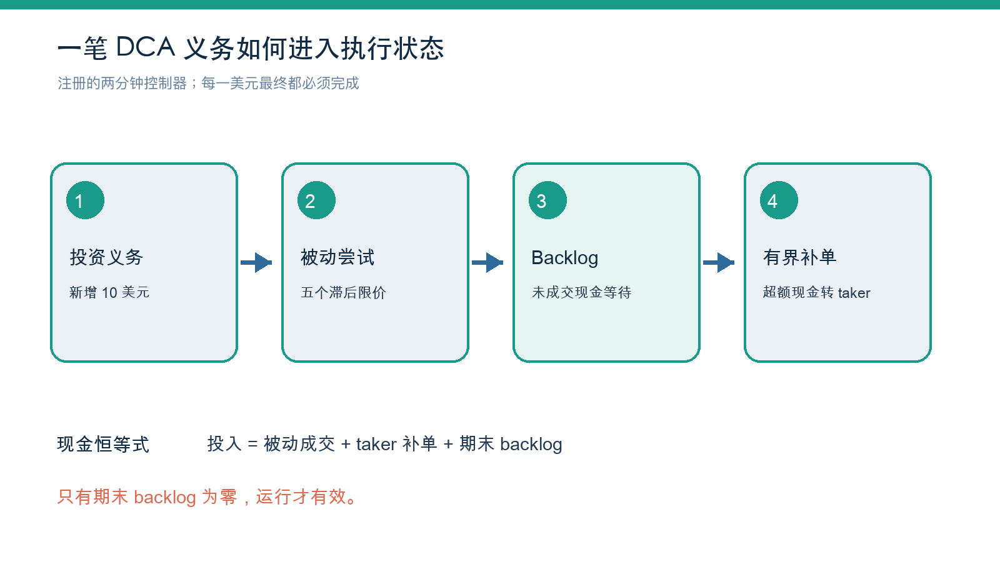
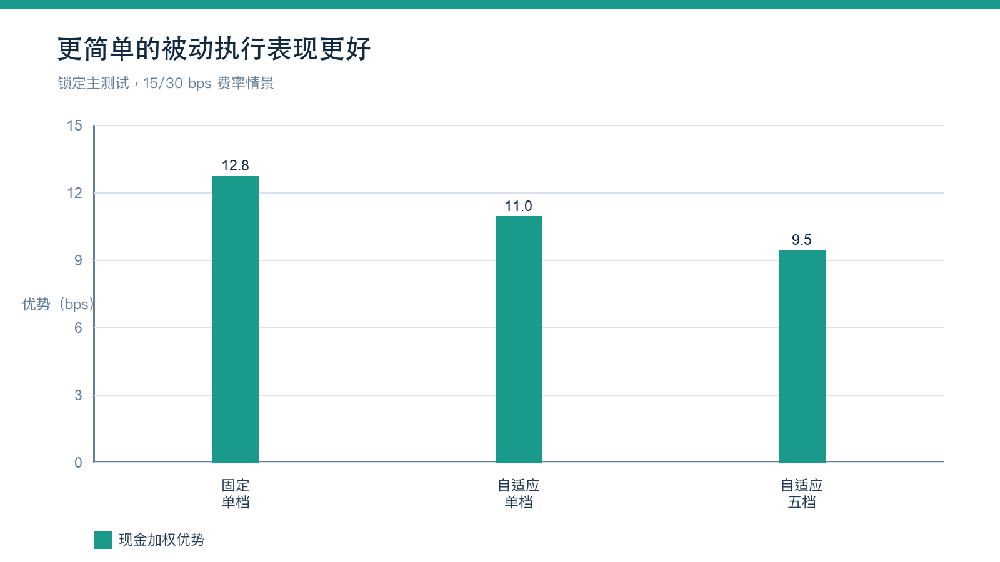
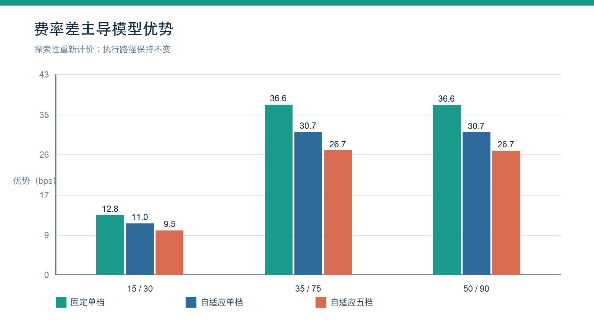
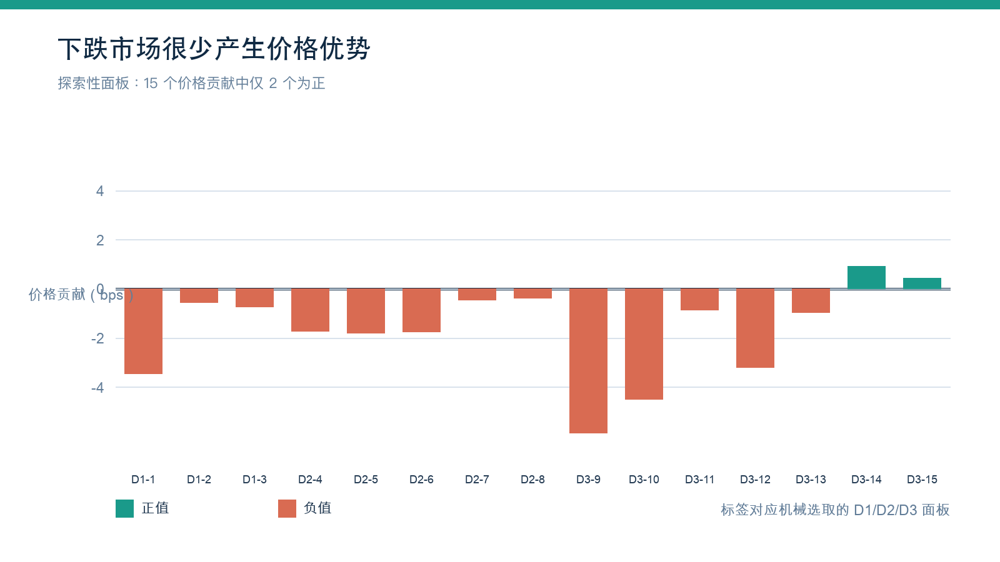
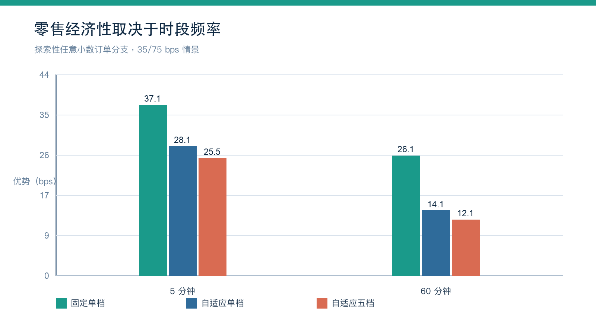
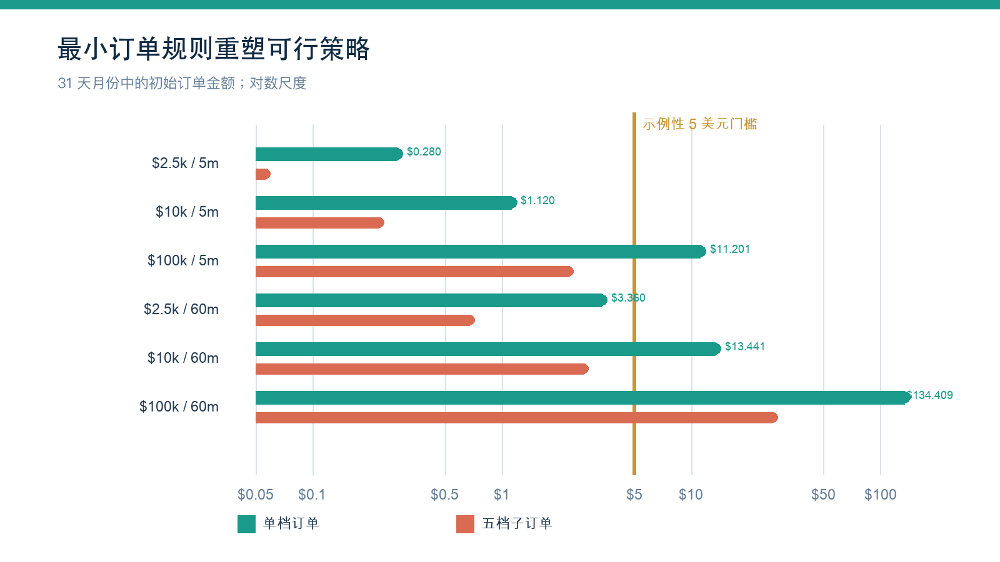

# 费用感知型被动定投

## 比特币积累策略的 K 线证据与零售规模可行性

**陶涛**  
独立研究者  
工作论文 v1.0 - 2026 年 10 月 9 日

证据版本：`MLDCA candle evidence v1`  
注册协议：`MLDCA-EP-1.1`  
市场：Coinbase BTC-USD 现货  
数据：截至 2026 年 10 月 6 日 UTC 的一分钟 OHLC K 线

## 摘要

定投（Dollar-Cost Averaging，DCA）把储蓄决策与短期择时分开，但它并不决定每一笔定期投资应如何执行。立即成交会主动获取流动性并支付 taker 费；被动限价单可能支付更低的 maker 费，也可能在短暂回落时买得更便宜，但它也可能无法成交，使投资者在资产上涨时继续持有现金。本文研究的是在既定 DCA 计划之上增加一个有状态的被动执行层。

锁定的主实验每两分钟生成一笔 10 美元投资义务，将立即 taker 执行与五档被动限价单控制器进行比较。控制器只使用已经完成的 K 线，把未成交现金记入显式 backlog，并通过有上限的 taker 补单完成投资。在 Coinbase BTC-USD 一分钟 K 线上，注册的 15/30 个基点（bps）maker/taker 费率情景产生了 9.5065 bps 的现金加权数量优势；平稳 bootstrap 的单侧 95% 下界为 9.2565 bps。最重要的并非总数，而是精确分解：价格路径贡献为 -0.8710 bps，较低手续费贡献为 +10.3775 bps。固定单档被动参考策略取得 12.8327 bps，优于五档控制器。

计划后探索性分析得到四个进一步结论。第一，更宽的固定费率差会机械性地扩大模型优势：五档策略在 35/75 bps 下为 26.7472 bps，在 50/90 bps 下为 26.7060 bps。第二，更低买价并不是稳定的优势来源：在 15 个机械选取的下跌样本中，只有 2 个具有正的价格贡献；但在所测试费率情景下，15 个样本的费后总优势均为正。第三，在现金投入外生固定、执行节省未再投资的条件下，终值财富 bps 与所获得 BTC 数量 bps 完全相同，不存在额外的指数型“执行复利”。第四，现实中的最小订单限制会显著改变策略设计。在示例性的 5 美元最小订单下，每月投入 2,500 或 10,000 美元的用户更适合按小时聚合资金并提交一个被动订单，而五档拆单往往过于零碎。

以上均为 K 线模型结果，不是已经证实的真实 maker 成交。一分钟最低价无法揭示排队位置、post-only 接受状态、部分成交、延迟或历史产品规则。证据支持的结论应保持狭窄：当 maker/taker 费率差足够大时，“先被动、后限时补单”的简单执行政策可以降低既定 DCA 计划的模型成本；证据不支持短期价格预测 alpha，也不支持五档阶梯优于单档挂单。

**关键词：** 定投；限价单；maker-taker 费率；交易执行；比特币；零售交易；回测

## 1. 研究动机

DCA 最适合被理解为一种承诺规则：储蓄者预先选定预算与时间表，之后不要求每次投资都重新预测市场。这样的行为稳健性与订单如何执行是两个不同问题。既有研究既说明了定期投资对用户的吸引力，也指出当收益过程和交易成本进入模型后，DCA 并非在所有条件下都最优（Constantinides，1979；Khouja and Lamb，1999；Kirkby, Mitra, and Nguyen，2020）。

当 DCA 频率提高时，执行成本变得不可忽略。立即下单消除了未成交风险，却要为即时性付费；被动限价单可以降低手续费，也可能抓住短暂回落，但未成交的投资义务会形成现金拖累。如果最终不得不追价补单，其成交价可能比原本立即买入更差。因此，一个可用的被动 DCA 系统不能只有限价价格，还必须具备投资义务账本、显式 backlog、截止时间与强制完成规则。

本文的研究问题是条件性的：

> 在现金投入序列已经确定的前提下，一个有界的被动优先执行策略，能否在不隐藏未投资现金的情况下，扣除模型手续费后比立即 taker 执行获得更多 BTC？

本文不比较 DCA 与一次性投入，也不把该策略解释成交易信号，更不推断交易所的主观意图。交易所的周期买入产品通常强调便利性和确定完成，但其具体路由机制可能不同，本文对此不作推断。本文只把用户的储蓄政策与面向交易所的执行政策分开，并在等现金口径下衡量后者。

## 2. 与现有设计的关系

限价单积累并非全新概念。US20130117198A1 已讨论用市价或限价执行日历型 DCA；JP2015036969A 描述了分层价格积累；US20190378214A 包含被动组件、漏单状态与补单机制。Coinbase 文档介绍了先被动、必要时转为主动的 TWAP 订单，Hummingbot 也提供多价格 DCA executor。因此，本系统不应被描述为“第一个限价 DCA”。

最接近的学术框架是同时使用限价单与市价单的最优执行。相关文献把价格、手续费、未成交风险、库存和完成约束放在同一框架中（Almgren and Chriss，2001；Cartea and Jaimungal，2015；Cont and Kukanov，2017）。队列反应模型尤其重要，因为价格触及并不等于订单成交（Huang, Lehalle, and Rosenbaum，2015）。Maker/taker 费率是一种市场结构激励，并非脱离逆向选择与排队风险的无风险收益（Foucault, Kadan, and Kandel，2013）。

本文检验的贡献更为有限：把连续的小额 DCA 投资义务表示为有状态执行问题；只使用滞后信息；显式携带未成交现金；强制有界完成；把两个反事实策略映射到相同的现金义务；并将优势精确拆分为价格与手续费两部分。本文还报告一个负面的设计结论：在注册的 K 线假设下，复杂的五档控制器不如固定单档被动策略。

## 3. 策略与核算

### 3.1 投资义务状态

在时段 `t`，新增现金义务为 `c_t`。若进入该时段的被动 backlog 为 `B_t^-`，可用现金为：

`I_t = B_t^- + c_t`。

注册控制器计划提交的被动现金为：

`P_t = min(I_t, c_t + alpha B_t^-, M c_t)`，

其中 `alpha = 0.5`，`M = 5`。主策略把这笔现金平均分配至五个买入限价。限价由前 720 个已完成的两分钟时段的最小收益分布分位数生成，并至少低于参考开盘价 1 bp。当前时段只有在全部决策完成后才进入历史样本。

未成交现金返回 backlog。当 backlog 超过 15 个时段预算时，超出部分被指定为 taker 补单，且最早只能在下一个可执行时段开盘成交。测试区间结束后不再产生新义务，并保留 24 小时结算窗口。结算后仍有未完成现金的运行被判为无效，而不是在不等现金基础上计算优势。

*图 1. 注册的 K 线状态机。它定义了投资义务、模拟被动尝试、backlog 与 taker 补单，并不证明真实成交。*

### 3.2 基准与策略数量

对基准价格 `A_t`（包含注册的 taker 点差/滑点）和 taker 费率 `f_T`，义务 `c_t` 获得的 BTC 为：

`q_t^B = c_t / [A_t (1 + f_T)]`。

若被动现金 `m_tk` 在限价 `L_tk` 成交，maker 费率为 `f_M`，taker 补单现金 `x_t` 在 `U_t` 执行，则策略获得：

`q^S = sum(m_tk / [L_tk (1 + f_M)]) + sum(x_t / [U_t (1 + f_T)])`。

现金恒等式为：

`sum(c_t) = sum(m_tk) + sum(x_t) + B_T`。

等终值现金比较要求 `B_T = 0`。这可防止策略仅因为没有投资而显得更优，但并不能消除延迟持仓的经济成本。

### 3.3 估计量与精确分解

每笔原始义务均通过 FIFO 归因跟踪。若策略和基准分配给义务 `i` 的 BTC 数量分别为 `q_i^S` 和 `q_i^B`，则该义务的优势为：

`e_i = 10,000 (q_i^S / q_i^B - 1)`。

注册的主指标是 `e_i` 的现金加权均值。主实验中的义务金额相等，因此它也等于义务级优势的算术平均。这样可以避免早期低价买入因每美元获得更多 BTC 而在总数量比率中获得过高权重。

在固定费率下，基础资产数量差可以精确分解为以 taker 费率计算的价格路径项，以及对被动现金重新分类费率的手续费项：

`Delta q_price = [sum(m/L) + sum(x/U) - sum(c/A)] / (1 + f_T)`，

`Delta q_fee = sum(m/L) [1/(1 + f_M) - 1/(1 + f_T)]`。

第一项衡量等待与补单是否改善了成交价格，第二项衡量同一组模拟被动成交采用 maker 而非 taker 费率所带来的机械数量差。

## 4. 数据与实证设计

冻结输入包含 5,837,137 条 Coinbase BTC-USD 一分钟 OHLCV 数据，时间从 2015 年 7 月 20 日至 2026 年 10 月 6 日 UTC。审计未发现重复时间戳、乱序行或无效 OHLC 行。协议所设的每分钟 10 美元名义成交额门槛以下共有 13,130 分钟。Coinbase 也说明，无成交时 K 线区间可能缺失，历史 K 线可能不完整。

数据按冻结时间划分：2022 年 4 月 13 日 UTC 之前为开发区间，之后至 2024 年 7 月 9 日为验证区间，随后为测试区间。由于早期探索已经查看过同一历史快照，这些标签只定义锁定回顾性协议中的角色，并不把测试区间变成完全独立的样本外证据。

主测试包含 588,240 笔 10 美元义务，每个反事实合计 5,882,400 美元。这是为了产生大量执行决策而设置的研究时钟，不代表普通家庭预算。后续零售探索分析改用月度预算钱包。

注册主单元如下：

| 设计项目 | 注册值 |
|---|---:|
| 产品 | Coinbase BTC-USD 现货 |
| 时段与义务 | 2 分钟；10 美元 |
| 预测窗口 | 720 个已完成时段；严格滞后 |
| 被动策略 | 5 个等现金分位数档位；最小偏移 1 bp |
| Backlog 控制器 | alpha 0.5；被动计划上限为 5 个时段预算 |
| 补单 | 超过 15 个时段上限的部分；下一可执行开盘 |
| K 线触发 | 延迟 1 分钟激活；穿透 1 bp |
| 模拟成交 | 50% haircut；每分钟名义成交额的 1% 容量 |
| 主费率 | 被动 15 bps；taker 30 bps；taker 滑点 2 bps |
| Bootstrap | 按日平稳区块；期望长度 7 天；10,000 次 |
| 主阈值 | 单侧 95% 下界高于 1 bp |

费率组合是实验输入，并非对某个账户在某一天费率的陈述。实际 Advanced 费率取决于产品、等级、交易量及 maker/taker 状态。主实验的两分钟频率本身会改变滚动交易量，但模型刻意不模拟费率等级迁移。

主分支为 `idealized_candle`。研究没有冻结带日期的历史最小名义金额、价格精度和数量精度规则。五档初始子订单可能只有约 2 美元，因此主测试不能证明每个子订单在历史上都可提交。模拟被动成交要求限价在激活延迟之后被合格 K 线最低价至少穿透 1 bp；请求现金再乘以 50% haircut，并受每分钟名义成交额 1% 的约束。这些规则降低了最宽松的“触价即成交”偏差，但无法重建事件顺序、价位成交量、前方队列、拒单、延迟或真实 maker 分类。

## 5. 锁定主结果

### 5.1 主结果与分解

五档策略的现金加权义务优势为 **9.5065 bps**。Bootstrap 单侧 95% 下界为 **9.2565 bps**，百分位上界为 9.7626 bps，相对于 1 bp 阈值的中心化 bootstrap 单侧 p 值为 0.00010。588,240 笔义务全部完成，现金守恒误差约为 4.05e-8 美元。

价格路径贡献为 **-0.8710 bps**，被动手续费贡献为 **+10.3775 bps**。模拟被动现金占 69.27%，taker 补单占 30.73%。平均未完成 backlog 为 134.31 美元，补单前最大 backlog 为 2,090 美元。因此，模型优势是用真实的等待和补单风险换取的手续费效应，而不是控制器预测到更低价格的证据。

Bootstrap 区间只衡量注册 K 线模型下的历史路径重采样，不包括协议前的规格搜索、成交模型错误、交易所规则不确定性或未来市场状态变化。

### 5.2 五档阶梯没有增加价值

固定单档被动参考策略取得 12.8327 bps，自适应单档取得 11.0270 bps，而五档策略为 9.5065 bps。五档减固定单档的配对差为 -3.3262 bps，95% 区间为 [-3.4900, -3.1543] bps。固定单档的模拟被动占比也更高（95.60%），平均 backlog 更低（67.92 美元）。

*图 2. 锁定的 K 线比较。注册的五档控制器不如两个单档策略。*

五个自适应档位能够增加价值的注册假设没有得到支持。复杂性把每笔义务切得更碎，降低了被动完成率并增加 backlog。实务系统应从单个被动订单开始，只有当真实订单规则和队列数据证明多档具有净优势时，才增加档位。

### 5.3 有效性与失败边界

在 732 次注册动态运行中，687 次有效，45 次在结算窗口后仍有未完成现金。无效运行不在不等现金基础上计算优势。激活延迟的影响特别显著：0 分钟延迟产生 11.7561 bps，注册的 1 分钟延迟产生 9.5065 bps，而 2 分钟延迟在订单的两分钟生命周期内没有被动机会，结果为 -0.0438 bps。该敏感性说明，K 线触价不能被当作稳定的真实收益估计。

## 6. 计划后探索性分析

本节分析均在注册主研究之后设计，用于回答经济与实现问题，但不构成对原始假设的新增验证性检验。

### 6.1 更宽的固定费率情景

在保持各策略模拟执行路径不变的情况下，五档策略优势从 15/30 bps 下的 9.5065 bps，提高到 35/75 bps 下的 26.7472 bps，以及 50/90 bps 下的 26.7060 bps。后两个情景的 maker/taker 差均接近 40 bps，因此尽管绝对费率更高，手续费贡献几乎相同。固定单档始终最好：三个情景分别为 12.8327、36.6180 和 36.5611 bps。

| 策略 | 15/30 bps | 35/75 bps | 50/90 bps |
|---|---:|---:|---:|
| 固定单档 | 12.8327 | 36.6180 | 36.5611 |
| 自适应单档 | 11.0270 | 30.7164 | 30.6693 |
| 自适应五档 | 9.5065 | 26.7472 | 26.7060 |

*图 3. 探索性的固定费率情景。它们是模型输入，不是某个 Coinbase 账户当前费率的核实结果。*

关键变量不只是 maker 费率，而是费率差乘以真正以 maker 方式成交的现金占比，再减去等待带来的价格和完成成本。实盘策略应读取用户当前费率，并在预期节省无法超过保守阈值时停用或降低被动优先路由。

### 6.2 下跌市场样本

三种机械选样规则共产生 15 个下跌观察：3 个负收益完整年度、5 个连续负收益月份区间和 7 个严重下跌月份。只有 2 个观察的价格贡献为正（2022 年 6 月：+0.9151 bps；2026 年 6 月：+0.4290 bps）。在每个测试费率情景下，15 个观察的费后总优势均为正；在 15/30 bps 下，最小总优势为 5.0444 bps。

*图 4. 机械选取的下跌市场样本中的探索性价格贡献。多数观察虽然处于下跌期，价格贡献仍为负。*

这一结果否定了一个直觉上诱人但过于宽泛的故事：市场下跌并不自动意味着被动 DCA 比立即执行买得更便宜。时段内路径、成交概率和之后的补单比月度或年度收益方向更重要。被测试策略更稳定的模型优势来源仍然是费率差。

### 6.3 财富与“复利”

在现金投入外生、没有卖出、执行节省也没有再投资时，两种组合都按同一个期末价格估值，因此相对终值财富差恰好等于 BTC 数量差。执行优势会保留下来，其美元价值会随投入金额与资产价格变化，但反复报告 bps 并不会额外产生指数增长项。

把各日历年度独立初始化并按数量合并后，探索性优势在 15/30、35/75 和 50/90 bps 三个情景下分别为 4.8228、14.0256 和 14.0036 bps。这些数字不应被理解为收益预测。真正的复利需要不同政策，例如把节省的手续费重新投入，并需要单独的协议、资金核算与风险分析。

### 6.4 零售与高投入用户预算

尽管每次决策金额很小，主实验的高频计划仍会产生机构级年度交易额。独立的探索性用例模型因此把每月 2,500、10,000 与 100,000 美元预算精确分配到五分钟或一小时时段。该模型使用新的全时段挂单窗口，并非注册的两分钟估计量。

在允许任意小数金额的分支中，bps 与预算规模无关：预算只改变美元影响，不改变相对优势。在 35/75 bps 下，固定单档在五分钟和一小时时段的优势分别为 37.0716 和 26.0523 bps；自适应五档较低，分别为 25.5483 和 12.1106 bps。

订单可行性会打破这种尺度不变性。在 31 天的月份中，每月 2,500 美元仅对应五分钟 0.280 美元或每小时 3.360 美元。五档子订单分别只有 0.056 与 0.672 美元。每月 10,000 美元时，五档子订单也只有 0.224 与 2.688 美元。在示例性的 5 美元最小订单下，这些子订单无法按原设计提交。

*图 5. 35/75 bps 情景下，不同时段与控制器的探索性用例优势。*

*图 6. 月度预算钱包产生的初始订单金额。5 美元线是示例阈值，并非历史规则回放。*

在该示例门槛下，每月 2,500 美元配合每小时固定单档仍保留 25.8548 bps 的模型优势；五分钟订单因始终不能满足被动提交条件而只有 -0.3062 bps。每月 10,000 美元时，每小时固定单档为 26.0728 bps；每小时五档的初始子订单仍未达到门槛，结果为 -0.4347 bps。每月 100,000 美元时，两种频率和五档阶梯在金额上都可行，但固定单档仍有更高模型优势。

相应的年度优势金额代理值，即年度投入乘以模型 bps，约为：每月 2,500 美元、每小时固定单档 77.56 美元；每月 10,000 美元、每小时固定单档 312.87 美元；每月 100,000 美元、五分钟固定单档 4,447.60 美元。它是执行成本量级指标，不是投资利润。

## 7. 证据所指向的实务策略

对零售实现而言，最可辩护的设计比原提案更简单：

1. 把每笔计划投入积累到预算钱包，不强行提交低于最小金额的订单。
2. 钱包满足当前产品规则后，在透明参考价格附近提交一个 post-only 买单。
3. 只允许订单停留有限时间，并记录接受、拒绝、部分成交、手续费分类及与队列相关的事件。
4. 显式记录未成交现金，绝不把它计入已投资表现。
5. 达到年龄或金额上限时，撤单并用可成交订单完成，同时设置最大参与率。
6. 当实时 maker/taker 差、成交概率或等待成本无法超过保守阈值时，停用或缩小被动优先路由。
7. 只有当每个子订单满足当前最小规则，且实盘数据证明复杂性有价值时，才把多档作为可选实验。

最合适的时钟取决于预算。对每月 2,500 至 10,000 美元，示例规则下按小时聚合比五分钟拆单更现实。对每月 100,000 美元，五分钟计划在名义金额上可行，但 API 可靠性、市场冲击、滚动费率等级变化和真实队列结果会更加重要。

## 8. 限制

第一，K 线最低价不等于成交。模型无法观察 post-only 订单是否在交易发生前已被接受并挂入订单簿、限价处实际成交量、前方排队量、部分成交情况或最终 maker 分类。

第二，OHLC K 线没有买卖盘状态。基准使用注册的点差/滑点，而非重建卖方 VWAP。被动模型用每分钟名义成交额作为粗略容量约束，而非限价处成交量。

第三，费率是固定情景。真实策略的滚动交易量可能改变等级，交易所规则也会变化。研究没有可用于历史回放的带日期最小金额与精度规则，5 美元只是示例阈值。

第四，锁定研究是回顾性的，早期探索使用了同一个历史快照。Bootstrap 描述条件路径不确定性，而不是完整研究流程的不确定性或未来表现。

第五，证据只覆盖一个交易所、一种资产和一个 K 线来源，不能证明对其他资产、交易所、市场结构或司法辖区具有普遍性。

第六，模型未计入税务、入金与出金成本、宕机、速率限制、撤单失败、自成交预防、成交后的逆向选择和市场冲击。对每月 100,000 美元的预算，这些遗漏尤其重要。

## 9. 结论

DCA 时间表与执行方式是两个不同的设计选择。在注册的 K 线研究中，有界的被动优先控制器在模型费率下比立即 taker 执行获得更多 BTC，但结果主要来自 maker/taker 费率差。价格贡献为负，最初提出的五档自适应阶梯也不如固定单档被动订单。

探索性分析进一步支持这种更窄的解释：更宽费率差会机械增加优势；下跌市场不会可靠地产生更好被动价格；若不再投资，执行 bps 不会额外指数复利；最小订单规则也使原始高频五档设计不适合常见零售预算。因此，证据更支持预算钱包、单个 post-only 订单、显式 backlog 与有界 taker 完成。

下一步实证研究不应继续优化 K 线模型，而应开展前瞻性的模拟交易或小额实盘研究，使用 L2 订单簿和完整订单生命周期日志。在宣称真实经济优势之前，必须测量订单接受、排队位置、部分成交、maker 分类、撤单、补单价格和费率等级迁移。

## 声明

**资金来源。** 本研究未获得外部资金支持。

**利益冲突。** 作者声明不存在竞争性利益冲突。

**致谢与 AI 工具使用。** 作者使用 OpenAI 的 ChatGPT 和 Codex 协助代码工作、文献整理、草稿撰写和编辑审阅。研究设计由作者主导，实证问题由作者选择，代码与输出由作者审阅，报告结果由作者核实，作者对全文承担最终责任。无其他致谢事项。

**数据可得性。** 本文不随论文重新分发 Coinbase 原始或衍生 K 线记录。论文只发布聚合结果。希望复现研究的读者必须独立取得合法可用的市场数据，并遵守数据提供方条款。

**代码与材料。** 公开研究包可以包含分析代码、配置、图表、校验值和聚合结果表，但不包含原始 K 线数据。论文、原创图表和聚合表采用 CC BY 4.0；Maker Limit DCA 发布包中明确包含的研究代码采用 MIT License。第三方来源材料、商标、链接内容和市场数据不在上述授权范围内。

**研究状态。** 本文为独立工作论文，未经同行评审，也不构成投资建议。所有表现均为历史模型输出，不保证未来执行或收益。

## 参考文献

Almgren, R., and Chriss, N. (2001). “Optimal Execution of Portfolio Transactions.” *Journal of Risk*, 3(2), 5-39. doi:10.21314/JOR.2001.041.

Cartea, Á., and Jaimungal, S. (2015). “Optimal Execution with Limit and Market Orders.” *Quantitative Finance*, 15(8), 1279-1291. doi:10.1080/14697688.2015.1032543.

Constantinides, G. M. (1979). “A Note on the Suboptimality of Dollar-Cost Averaging as an Investment Policy.” *Journal of Financial and Quantitative Analysis*, 14(2), 443-450. doi:10.2307/2330513.

Cont, R., and Kukanov, A. (2017). “Optimal Order Placement in Limit Order Markets.” *Quantitative Finance*, 17(1), 21-39. doi:10.1080/14697688.2016.1190030.

Foucault, T., Kadan, O., and Kandel, E. (2013). “Liquidity Cycles and Make/Take Fees in Electronic Markets.” *The Journal of Finance*, 68(1), 299-341. doi:10.1111/j.1540-6261.2012.01801.x.

Huang, W., Lehalle, C.-A., and Rosenbaum, M. (2015). “Simulating and Analyzing Order Book Data: The Queue-Reactive Model.” *Journal of the American Statistical Association*, 110(509), 107-122. doi:10.1080/01621459.2014.982278.

Khouja, M., and Lamb, R. P. (1999). “An Optimal Schedule for Dollar Cost Averaging under Different Transaction Costs.” *International Transactions in Operational Research*, 6(2), 245-261. doi:10.1111/j.1475-3995.1999.tb00154.x.

Kirkby, J. L., Mitra, S., and Nguyen, D. (2020). “An Analysis of Dollar Cost Averaging and Market Timing Investment Strategies.” *European Journal of Operational Research*, 286(3), 1168-1186. doi:10.1016/j.ejor.2020.04.055.

Coinbase. (2026a). “Recurring Buys.” 访问日期：2026 年 10 月 7 日。https://help.coinbase.com/en-in/coinbase/trading-and-funding/buying-selling-or-converting-crypto/how-can-i-create-or-cancel-a-recurring-transaction.

Coinbase. (2026b). “Coinbase Advanced Fees.” 访问日期：2026 年 10 月 7 日。https://help.coinbase.com/en-gb/coinbase/trading-and-funding/advanced-trade/advanced-trade-fees.

Coinbase. (2026c). “Advanced Trade Order Types.” 访问日期：2026 年 10 月 7 日。https://help.coinbase.com/en-in/coinbase/trading-and-funding/advanced-trade/order-types.

Coinbase Developer Platform. (2026). “Get Product Candles.” 访问日期：2026 年 10 月 7 日。https://docs.cdp.coinbase.com/api-reference/exchange-api/rest-api/products/get-product-candles.

Hogan, D. M. (2013). “Intellectual Property Method for Dollar Cost Averaging Investment Plan Process for Ongoing Stock Investing.” US20130117198A1. https://patents.google.com/patent/US20130117198A1/en.

Hummingbot Foundation. (2026). “DCAExecutor Source Code.” 访问日期：2026 年 10 月 7 日。https://github.com/hummingbot/hummingbot/blob/master/hummingbot/strategy_v2/executors/dca_executor/dca_executor.py.

Umada, N. (2015). “Saving Method of Financial Product, Purchasing Price Diversified Saving Product Using Limit Order.” JP2015036969A. https://patents.google.com/patent/JP2015036969A/en.

“Computerized Method and System for Accumulation and Distribution of Securities.” (2019). US20190378214A1. https://patents.google.com/patent/US20190378214A1/en.
